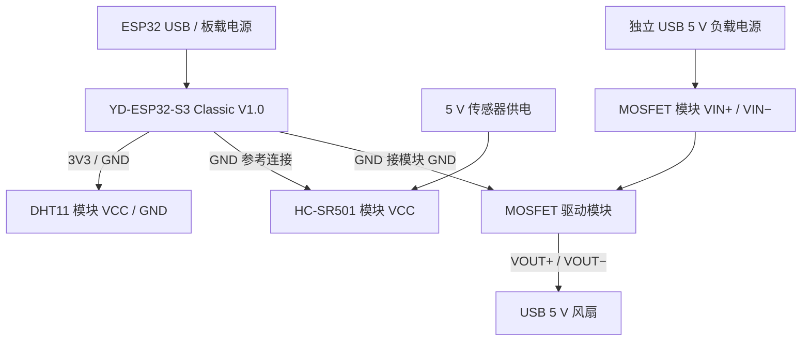
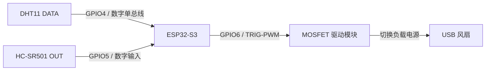

# 供电与控制电路分析

- 状态：已整理用户实际接线与已有单项测试；部分电气参数待仪器/资料核实
- 最近更新日期：2026-11-25
- 主控板：YD-ESP32-S3 Classic V1.0
- 关联实验：EXP-001、EXP-005、EXP-009、EXP-012
- 接线依据：用户按项目调试过程中确认的接线方案完成连接；并与仓库 `experiment/hardware_connection_log.md` 中的引脚分配和后续状态更新交叉核对。

> 本文把“实际接线/用户确认”“单项功能测试通过”和“电气参数已测量”分开记录。没有仪器读数的电压、电流、温升及模块规格不伪装成实测结果。

## 1. 供电路径

| 起点 | 终点 | 电压/电流 | 依据（标签/手册/实测） | 证据 | 状态 |
|---|---|---|---|---|---|
| ESP32-S3 开发板 3V3 | DHT11 模块 VCC | 3.3 V（接线方案） | 用户确认的接线方案；DHT11 已由 GPIO4 成功读取 | EXP-001；hardware_connection_log.md | 已用于读取测试；未单独测量供电端电压 |
| ESP32-S3 开发板 GND | DHT11 模块 GND | GND | 用户确认的接线方案 | EXP-001；hardware_connection_log.md | 接线/读取功能有记录 |
| 5 V 电源 | HC-SR501 PIR 模块 VCC | 5 V（模块供电方案） | 用户确认模块使用 5 V；EXP-009 有 GPIO5 信号测试 | EXP-009；hardware_connection_log.md | 已进行信号测试；模块端实际电压及 OUT 高电平幅值未测 |
| ESP32-S3 开发板 GND | HC-SR501 PIR 模块 GND | GND | 按传感器数字信号接口的接地参考连接方案 | EXP-009 接线/信号记录 | 信号可读；接地点电位差未测 |
| 独立 USB 5 V 负载电源正极 | MOSFET 驱动模块 VIN+ | 5 V（电源标称） | 用户确认的实际接线；模块端子丝印 VIN+ | EXP-005 接线记录；EXP-012 独立风扇测试 | 已用于独立风扇基本驱动；电源输出实测值未记录 |
| 独立 USB 5 V 负载电源负极 | MOSFET 驱动模块 VIN− | 电源负极 | 用户确认的实际接线；模块端子丝印 VIN− | EXP-005；EXP-012 | 已用于独立风扇基本驱动 |
| MOSFET 驱动模块 VOUT+ / VOUT− | USB 风扇正极 / 负极 | 风扇标称 5 V；电流未实测 | 用户确认红线接 VOUT+、黑线接 VOUT−；风扇说明书记录 5 V / 2.5 W，商家另提供约 1 A 信息 | EXP-005；EXP-012；hardware_inventory.md | 风扇基本启停及全开连续运行已观察；电流/启动电流未测 |
| ESP32-S3 GND | MOSFET 驱动模块 GND | 信号参考地 | 用户确认实际连接；模块端子丝印 GND | EXP-005 后续接线补充；EXP-012 | 独立测试已观察基本开关；模块内部拓扑和共地电气细节仍待核实 |

**重要供电说明：**风扇使用独立 5 V 负载电源，经 MOSFET 模块 VIN+/VIN− 输入，再由 VOUT+/VOUT− 接至风扇；ESP32 GPIO 不直接承担风扇电机电流。不要把独立负载电源正极与 ESP32 USB/5V 电源正极并接。修改接线前先断开负载电源。

## 2. 控制信号路径

| 控制端 | 被控模块 | 信号类型/逻辑电平 | 依据 | 证据 | 状态 |
|---|---|---|---|---|---|
| ESP32-S3 GPIO4 | DHT11 DATA | 数字单总线数据 | 固件 DHT 驱动配置及实际读取记录 | EXP-001：22/22 次读取成功 | DHT11 单项读取已验证 |
| HC-SR501 OUT | ESP32-S3 GPIO5 | 数字输入；观察到 HIGH/LOW，实际高低电平电压未测 | 固件 GPIO 配置及 PIR 原始信号测试 | EXP-009：烧录成功，观察到 8 次 HIGH/LOW 周期，静止期间约 38 s LOW | 初步信号读取已验证；检测距离、角度、误触发率和 OUT 电压待测 |
| ESP32-S3 GPIO6 | MOSFET 驱动模块 TRIG/PWM | 数字/PWM 控制输出；触发极性和输入阈值未测 | 用户确认 GPIO6 接 TRIG/PWM；独立测试程序 | EXP-012：观察到基本 OFF/ON 和 100% 连续运行 | 基本开关/全开已验证；中间 PWM 档位及逻辑电平兼容性待测 |
| MOSFET 驱动模块 VOUT+/VOUT− | USB 风扇 | 经驱动模块切换的负载供电，不是 GPIO 逻辑信号 | 用户确认端子接线及独立运行测试 | EXP-012 | 基本启停已观察；不代表调速范围、效率或长期可靠性已验证 |

## 3. 供电与控制框图

### 3.1 供电框图

下图按已确认的接线关系绘制。DHT11、PIR 的供电连接按当前接线方案标注；独立负载电源与 ESP32 供电保持分开。

### 3.2 控制信号框图

### 3.3 每条连接的核实依据

- DHT11 DATA → GPIO4：EXP-001 已有 22/22 次读取成功记录。
- HC-SR501 OUT → GPIO5：EXP-009 已有烧录及 HIGH/LOW 信号观察记录；未测 OUT 电压幅值。
- GPIO6 → MOSFET TRIG/PWM：用户接线确认，EXP-012 已观察到风扇基本启停及 100% 连续运行。
- 独立 5 V 电源 → VIN+/VIN−，VOUT+/VOUT− → 风扇正负极：用户接线确认，EXP-012 有独立驱动运行记录。
- ESP32 GND → MOSFET GND：用户接线确认；驱动模块内部电路拓扑和输入电气规格尚未取得可靠资料。

## 4. 安全与限制

1. 风扇电机负载由独立 5 V 电源和 MOSFET 驱动模块承担，不直接连接 ESP32 GPIO。
2. 独立负载电源正极不得与 ESP32 USB/5V 正极并接；更改接线前先断开负载电源。
3. 当前风扇说明书记录 5 V / 2.5 W，按额定功率换算约 0.5 A；用户另提供商家约 1 A 信息。两者来源不同，不能写成实测电流，启动/堵转电流仍未知。
4. 尚未核实 MOSFET 模块具体型号、芯片、板卡修订、输入阈值、触发极性和额定电流；不得仅凭“支持 PWM”字样推断与所有风扇兼容。
5. GPIO6 的独立测试证明基本开关及 100% 连续运行，不证明中间 PWM 档位调速效果或主程序完整集成。
6. PIR GPIO5 测试只证明初步信号读取；OUT 电压、检测距离、角度及误触发率仍待测。
7. 本文没有记录电源端电压、负载电流、启动电流、模块温升或纹波的仪器实测值。后续测量应记录仪器、量程、测量位置和实验条件。

## 5. 结论

目前已经形成可追溯的基础连接关系：DHT11 通过 GPIO4 向 ESP32-S3 提供温湿度数据；HC-SR501 通过 GPIO5 提供人体活动数字信号；ESP32-S3 通过 GPIO6 控制 MOSFET 模块的 TRIG/PWM 输入；风扇由独立 5 V 负载电源经 MOSFET 模块供电。

已有实验分别支持 DHT11 读取、PIR 初步信号读取、MOSFET 风扇基本启停/全开运行。整机自动控制和网页远程控制的端到端实机闭环尚未完成验证。电流、启动电流、模块温升、PWM 中间档位及驱动器电气规格仍需进一步核实。
