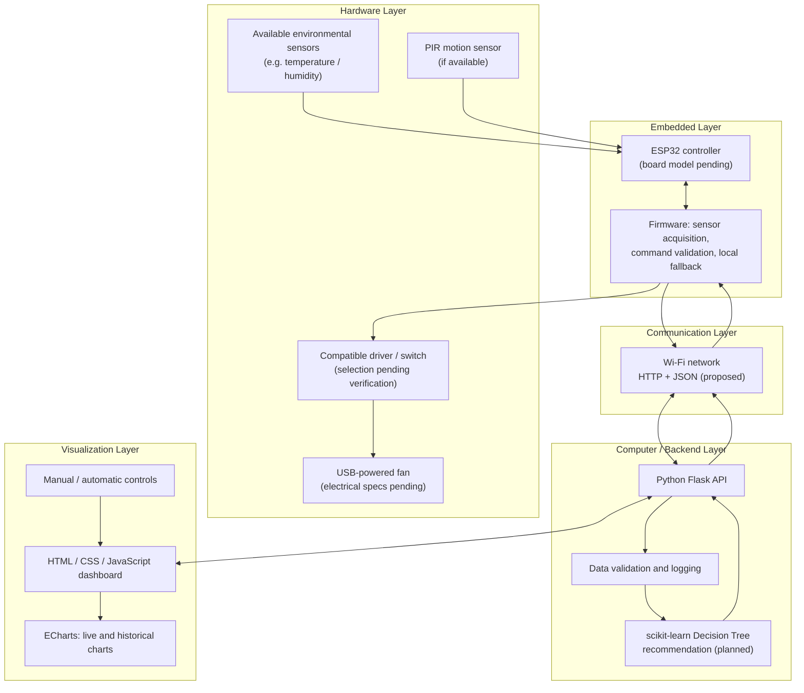
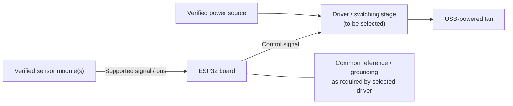
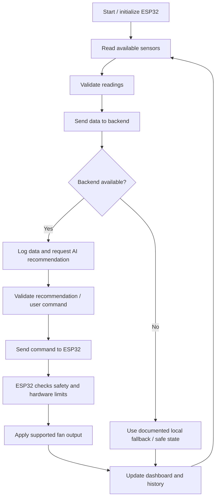

# SmartFan 2.0 — System Architecture

**Project:** An ESP32-Based AI Smart Fan and Visualization System  
**Document:** System Architecture Design  
**Version:** 1.0  
**Status:** Preliminary Design — Hardware Verification Pending  
**Last Updated:** November 6, 2026

> **Document status:** This document describes the proposed architecture, not a completed prototype. Hardware models, electrical ratings, wiring, APIs, model results and test outcomes must be updated only after verification.

## 1. Purpose and Scope

This document defines the planned system structure, module responsibilities, communication flow, AI decision process, dashboard functions and safety boundaries for SmartFan 2.0.

The initial design separates the system into five logical layers:

1. Hardware and sensing
2. ESP32 firmware
3. Wi-Fi communication
4. Python backend and AI
5. Web dashboard and data visualization

The exact ESP32 board, sensors, driver circuit and power arrangement remain subject to inspection of the ESP-Claw kit and verification of the purchased USB-powered fan.

## 2. Overall System Architecture

The ESP32 is planned to acquire sensor readings and execute validated fan commands. A computer on the same Wi-Fi network is planned to host the Python backend and initial machine-learning model. A browser-based dashboard will display device data and provide user controls through the backend.

### 2.1 System Architecture Diagram



**Figure 1. Proposed logical system architecture.** The diagram shows intended data and command paths. It is not a wiring diagram; physical connections must be designed after component identification.

### 2.2 Main Data and Control Path

1. Sensors provide measurements or activity signals to the ESP32, if those sensors are present and supported.
2. The ESP32 validates and packages available readings.
3. The ESP32 sends data to the computer over the selected Wi-Fi communication method.
4. The backend validates and records the received data.
5. The AI module may generate a recommended operating level using a trained and evaluated model.
6. The backend returns a recommendation or control command.
7. The ESP32 checks the command against local safety limits before applying it.
8. The dashboard displays readings, recommendations, connection state and commanded fan level.

The ESP32 should retain a simple local fallback strategy for loss of backend or network communication. The exact fallback behavior will be defined and tested during implementation.

## 3. Hardware Architecture

### 3.1 Candidate Components and Verification Status

| Component | Intended responsibility | Current status |
|---|---|---|
| ESP32 development board | Sensor acquisition and device control | Exact board model pending kit inspection |
| Temperature / humidity sensor | Environmental measurements | Exact sensor and availability pending |
| PIR sensor | Detect movement events | Availability and model pending |
| USB-powered fan | Airflow output | Purchased; rated voltage/current and startup current not verified |
| Motor driver or switching circuit | Interface between ESP32 and fan power circuit | Not selected; requires fan and driver compatibility checks |
| Power source and wiring | Supply power and connect modules | Must be confirmed after inspection and electrical verification |

Do not assume that a sensor or driver is included until it has been physically identified.

### 3.2 Hardware Block Diagram



**Figure 2. Conceptual hardware block diagram.** This is a functional illustration only. It does not specify pin numbers, voltage levels, wiring, or a confirmed circuit.

### 3.3 Hardware Safety Requirements

- Never connect a motor directly to an ESP32 GPIO pin.
- Verify the fan's rated voltage, operating current and startup current before selecting a driver or power supply.
- Confirm whether the fan contains internal electronics and whether its speed can be controlled externally.
- Check the driver module's input logic, current rating, voltage rating and thermal requirements.
- Confirm voltage compatibility for every sensor and module.
- Use appropriate laboratory equipment and instructor supervision for electrical measurements.
- Disconnect power before changing wiring.
- Do not infer a fan's electrical rating from the fact that it uses a USB connector.

### 3.4 Fan Control Feasibility Gate

The proposed OFF / LOW / MEDIUM / HIGH levels are target behaviors, not confirmed capabilities. They may be implemented only if the fan and selected driver support safe and repeatable control. If only on/off control is feasible, the firmware, AI output classes and dashboard must be revised accordingly.

## 4. ESP32 Firmware Architecture

### 4.1 Responsibilities

The planned firmware will:

- Initialize the verified board and connected sensors.
- Read supported sensor measurements.
- Attach timestamps or sequence information where appropriate.
- Connect to the configured Wi-Fi network.
- Send device data to the backend.
- Receive and validate control commands.
- Apply only supported and safe fan commands.
- Enter a documented local fallback behavior if communication is lost.

### 4.2 Planned Firmware Modules

| Module | Responsibility |
|---|---|
| Sensor interface | Read and validate measurements from identified sensors |
| Network manager | Connect and reconnect to Wi-Fi |
| Data encoder | Build the documented JSON payload |
| Command handler | Parse and validate backend commands |
| Fan controller | Drive the verified output interface |
| Safety and fallback | Reject unsupported commands and handle communication failures |

The firmware language and framework will be selected after confirming the exact ESP32 board.

## 5. Communication Architecture

### 5.1 Proposed Communication

The initial proposal is Wi-Fi with HTTP and JSON between the ESP32 and a Python backend running on a computer on the same network. This is a proposed interface; endpoint paths, authentication, update interval and retry behavior will be finalized during implementation.

### 5.2 Illustrative Sensor Payload

The following JSON is an example schema only. Values are illustrative and are not measured project data.

```json
{
  "device_id": "smartfan_01",
  "timestamp": "2026-11-06T10:00:00Z",
  "temperature_c": 28.5,
  "humidity_percent": 65.0,
  "motion_detected": true
}
```

Fields will be included only when the corresponding sensor exists and produces valid readings. The timestamp convention and device identifier format will be finalized in the firmware/backend interface specification.

### 5.3 Illustrative Command Payload

```json
{
  "mode": "automatic",
  "fan_level": "LOW",
  "command_id": "example-command-001"
}
```

This example does not imply that LOW speed has been verified. The ESP32 must reject any command outside the capabilities established by hardware testing.

## 6. Backend Architecture

### 6.1 Planned Technology

- Python
- Flask
- pandas / NumPy for data handling where needed
- scikit-learn for the initial machine-learning model

### 6.2 Responsibilities

The backend is planned to:

- Receive device messages.
- Validate required fields and data ranges.
- Store timestamped sensor readings and command history.
- Call the AI recommendation module when valid inputs are available.
- Expose status, history and control interfaces to the dashboard.
- Handle unavailable devices and malformed messages gracefully.

### 6.3 Candidate API Interfaces

| Endpoint | Method | Intended purpose | Status |
|---|---|---|---|
| `/api/sensor-data` | POST | Receive sensor readings | Proposed |
| `/api/status` | GET | Return current device state | Proposed |
| `/api/predict` | POST | Request an AI recommendation | Proposed |
| `/api/control` | POST | Submit a user control request | Proposed |
| `/api/history` | GET | Retrieve historical records | Proposed |

These are candidate interface names, not implemented endpoints.

## 7. AI Recommendation Architecture

### 7.1 Initial Model

A scikit-learn Decision Tree Classifier is proposed as the initial model because its decision paths can be visualized and explained.

### 7.2 Candidate Features

Potential inputs include:

- Temperature measured by a verified sensor.
- Humidity measured by a verified sensor.
- Motion state from a verified PIR sensor.
- Explicitly recorded user preference, if collected.

Only available, valid and documented features will be used. PIR output indicates detected movement; absence of a movement event does not prove that a room is unoccupied.

### 7.3 Target Labels

OFF / LOW / MEDIUM / HIGH are candidate output classes. The final classes must match the actual control capability of the fan and driver. If the hardware supports only on/off control, the model target must be reduced accordingly.

### 7.4 Training and Evaluation

Training labels must be based on a documented rule set or actual user-labeled observations. Rule-generated labels must not be presented as objectively measured comfort labels.

The dataset must be split into training and test data before model evaluation. Suitable evaluation outputs may include accuracy, precision, recall, F1-score and a confusion matrix. No performance metric will be reported until it has been calculated from actual held-out test data.

The AI output is a recommendation. The ESP32 remains responsible for local command validation and safe execution.

## 8. Control Modes and Failure Handling

### 8.1 Automatic Mode

1. Acquire available sensor readings.
2. Send valid readings to the backend.
3. Obtain a recommendation if the backend and model are available.
4. Validate the recommendation against the verified hardware capability.
5. Apply the supported command.
6. Record the recommendation and executed command separately.

### 8.2 Manual Mode

The dashboard submits a user request to the backend. The ESP32 validates the received command before execution. Unsupported fan levels must be rejected rather than silently treated as valid.

### 8.3 Offline / Fallback Mode

If Wi-Fi or the backend is unavailable, the ESP32 should use a predefined local fallback policy or enter a safe output state. The exact policy will depend on the verified hardware and will be documented after implementation and testing.

## 9. Dashboard and Visualization Architecture

### 9.1 Planned Frontend

- HTML and CSS for structure and layout.
- JavaScript for interaction and API communication.
- ECharts for time-series and status visualization.

### 9.2 Planned Dashboard Sections

**Real-time monitoring**
- Temperature and humidity, when supported.
- Motion event state, if a PIR sensor is installed.
- Device connection state.
- Automatic/manual mode.
- Fan commanded level.
- AI recommendation and its timestamp.

**Historical visualization**
- Temperature and humidity trends.
- Fan command-level timeline.
- Motion-event timeline, if supported.
- Comparison of AI recommendations and executed commands.

**AI analysis**
- Decision-tree visualization.
- Prediction output.
- Confusion matrix and evaluation metrics after valid testing.
- Prediction-versus-reference comparison.

**Remote control**
- On/off control.
- Automatic/manual mode selection.
- Supported fan-level selection.

If no tachometer or speed sensor is installed, the dashboard must display the commanded fan level, not measured RPM.

### 9.3 Planned Software Workflow



**Figure 3. Planned software and control workflow.** This flow describes the intended behavior and must be revised if implementation decisions change.

## 10. Data Management

The system is expected to distinguish and label:

- Simulated data used during early dashboard development.
- Real sensor measurements from the physical prototype.
- Training data used to fit the model.
- Held-out test data used for evaluation.
- AI recommendations.
- Commands requested by the user.
- Commands actually accepted and executed by the ESP32.

Each record should include an appropriate timestamp and, where useful, a device identifier. Missing or invalid sensor readings must not be silently replaced with fabricated measurements.

## 11. Reliability, Security and Safety

The implementation should consider:

- Input validation and sensible sensor value ranges.
- Wi-Fi reconnection and communication timeouts.
- Rejection of malformed or unsupported commands.
- A defined safe output state for startup and failure conditions.
- Separation of user requests, AI recommendations and executed commands.
- Basic access protection for remote-control endpoints before exposing the service beyond a trusted local network.
- Logging of errors and important state changes.

## 12. Current Architecture Status

| Subsystem | Status | Next verification step |
|---|---|---|
| USB-powered fan | Purchased; electrical specifications unverified | Record label/specifications and verify operating requirements |
| ESP32 board | Pending kit inspection | Identify exact model |
| Sensors | Pending kit inspection | Record exact models and supported measurements |
| Driver / switching circuit | Not selected | Select only after fan and power verification |
| Firmware | Planned | Begin after board and components are identified |
| Wi-Fi communication | Proposed | Confirm network and protocol during implementation |
| Flask backend | Planned | Implement and test API |
| Decision Tree model | Planned | Define labels and collect documented data |
| Dashboard | Planned | Build with clearly labeled simulated data first |
| Hardware integration | Not started | Perform supervised bench tests |
| System evaluation | Not started | Define and execute repeatable tests |

## 13. Design Decisions to Revisit

This document must be updated when the following facts become available:

1. Exact ESP32 board model and supported framework.
2. Actual sensor inventory and electrical interfaces.
3. Fan rated voltage, operating current and startup current.
4. Whether the fan supports external speed control.
5. Compatible driver and power arrangement.
6. Final communication protocol, API schema and update interval.
7. Actual model features, labels and evaluation results.

## 14. Conclusion

SmartFan 2.0 is designed as a layered embedded and IoT system connecting sensor acquisition, ESP32 control, Wi-Fi communication, Python-based AI recommendations and web visualization.

This architecture provides a starting point for implementation while keeping unverified hardware assumptions explicit. The document will evolve with component inspection, circuit verification, software implementation and experimental evidence.
